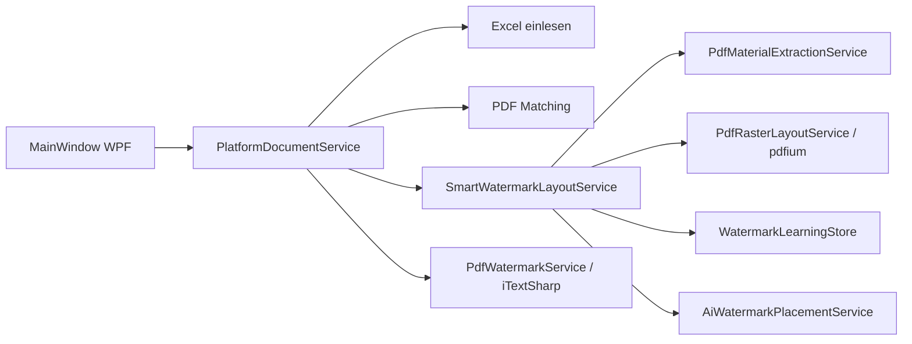

# DOK-V01 – KI-Handoff & Projektbeschreibung

**Lies diese Datei zuerst**, wenn du in einem neuen Chat an diesem Projekt arbeitest.

| Feld | Wert |
|------|------|
| Produkt | **DOK-V01** (Desktop-WPF-App) |
| Namespace / Ordner | `PDF_umbenenen` (historischer Name) |
| Version | `AppInfo.cs` → aktuell **1.1 R58** (`AssemblyVersion` `1.1.0.58`) |
| Zielgruppe | Blechbearbeitung / Tesla-Zeichnungen (TSL-*), Auftrags-PDF-Sortierung |
| GitHub | `Acid31-31/Tesla-Auftragsbearbeitung-und-Druck` |
| Framework | .NET Framework 4.8, WPF, C# |

---

## 1. Was die App tut

DOK-V01 verarbeitet **Technische Zeichnungen (PDF)** anhand einer **Excel-Auftragsdatei**:

1. **Laden** – Drag & Drop: Excel, PDFs, ZIP (mit PDFs + Excel)
2. **Sortieren & umbenennen** – Match Zeichnungsnummer ↔ Excel-Zeile, Dateien `01_…pdf`, `02_…pdf`
3. **Wasserzeichen** (optional) – Auftragsnummer, Lieferort, Menge, Datum, BG, **Material** (z. B. `VA-3,0mm`)
4. **Zusammenfügen & Vorschau** – eine `_GESAMT_YYYYMMDD_HHMMSS.pdf`
5. **Updates** – automatisch von GitHub-Releases

**Wichtig:** Es gibt **kein CLI-Sortieren** für Endnutzer – Batch läuft über die WPF-Oberfläche (`MainWindow`). Nur `Tools/PdfDiag` ist ein Entwickler-Diagnose-Tool.

---

## 2. Verzeichnisstruktur

```
PDF Sortieren/
├── PDF-umbenenen.csproj          # Hauptprojekt (WPF)
├── MainWindow.xaml(.cs)          # UI, Batch, Drag&Drop, Sortierung
├── PdfWatermarkService.cs        # iTextSharp: Wasserzeichen in PDF schreiben
├── AppInfo.cs                    # Version, Pfade, GitHub-Konstanten
├── PathStore.cs                  # Ablage-Ordner, Excel-Pfad
├── Services/                     # Geschäftslogik (siehe Abschnitt 4)
├── Platform/                     # Modulare Pipeline (OCR, Vision, Batch, Learning)
├── PDF-umbenenen/                # Zusätzliche Fenster (Preview, KI, Update, Install)
├── Tools/PdfDiag/                # Diagnose-CLI
├── bin/Debug|Release/            # Build-Ausgabe → DOK-V01.exe
├── native/win-x64/pdfium.dll     # Backup für Release/Repair
├── publish-github-release.ps1    # Release bauen + GitHub hochladen
├── create-usb-version.ps1        # USB-Installationspaket
├── sign-app.ps1                  # Code-Signing (Entwicklung)
├── BEDIENUNGSANLEITUNG.md        # Endnutzer-Anleitung
├── SECURITY_HINWEIS.md           # Antivirus / Zertifikat
└── .cursor/rules/                # Cursor-Regeln für KI-Sessions
```

---

## 3. Laufzeit-Pfade (Windows)

| Zweck | Pfad |
|-------|------|
| Installation (fest) | `C:\Program Files\DOK-V01\` |
| Arbeitsdaten / Ablage | `%LOCALAPPDATA%\DOK-V01\Ablage\` |
| Einstellungen | `%LOCALAPPDATA%\DOK-V01\` (`ai-settings.xml`, `watermark-settings.xml`, …) |
| **KI-Lernspeicher Wasserzeichen** | `%LOCALAPPDATA%\DOK-V01\Learning\watermark-placements.xml` |
| USB-Verteilung | `USB-Version\DOK-V01\` → `Programm installieren.exe` |

**Testdaten (real):** `F:\DOK-V01 Soft\` – Excel, ZIP, `zeichnungen\` (26 TSL-PDFs)

---

## 4. Kritische Module

### 4.1 Sortierung & UI
| Datei | Aufgabe |
|-------|---------|
| `MainWindow.xaml.cs` | Batch, Fortschritt, Wasserzeichen-Toggle, Platform-Anbindung |
| `Services/PlatformDocumentService.cs` | Dokument-Pipeline für Sort/Batch |
| `PathStore.cs` | Ablage, Excel `Daten.xlsx` |

### 4.2 Wasserzeichen-Platzierung (häufigste Fehlerquelle!)
| Datei | Aufgabe |
|-------|---------|
| `Services/SmartWatermarkLayoutService.cs` | Layout aller Wasserzeichen-Kategorien, `PlaceMaterialCenterStack`, `ApplyLearning` |
| `Services/AiWatermarkPlacementService.cs` | Raster-Korrektur: nur freie Ränder, `EnforceVisionLayout` |
| `Services/PdfRasterLayoutService.cs` | pdfium-Raster, Dunkelheits-Grid, `IsInsideDrawingCore`, `TryFindVisionMarginMaterialAnchor` |
| `Services/WatermarkLearningStore.cs` | XML-Lernspeicher – **Material wird seit R41 nie mehr angewendet** |
| `PdfWatermarkService.cs` | iTextSharp `ShowTextAligned` – schreibt finale Positionen |

**Koordinaten-Konvention Material (Alignment=1 / zentriert):**
- `placement.X` = Mitte des Textblocks
- `placement.Y` = **Baseline der obersten Zeile** (nicht Unterkante!)
- Anker-Suchfunktionen liefern `anchorBottomY` (Unterkante) → Umrechnung:  
  `topBaselineY = anchorBottomY + blockHeight - lineHeight`

**Prüfung:** `PdfRasterLayoutService.IsPlacementAcceptable(..., materialYIsBottomAnchor: false)` für Placements, `true` für Anker-Suchergebnisse.

### 4.3 Materialstärke (OCR / Regeln)
| Datei | Aufgabe |
|-------|---------|
| `Services/PdfMaterialExtractionService.cs` | Material aus PDF extrahieren |
| `Services/ThicknessCandidateResolver.cs` | Kandidaten, Korrektur falscher Werte (z. B. 20 statt 5 mm) |
| `Services/MaterialThicknessHybridResolver.cs` | Hybrid aus Schriftfeld + Seitenansicht |
| `Services/TitleBlockOcrService.cs` | Tesseract OCR Schriftfeld |

### 4.4 Native Abhängigkeiten
| Datei | Aufgabe |
|-------|---------|
| `Services/NativeDependencyService.cs` | pdfium 32/64-Bit, Repair aus `native\win-x64\` |
| `Services/PdfRasterLayoutService.cs` | Benötigt Docnet.Core + pdfium.dll neben EXE |
| `install-tesseract.ps1` | Tesseract CLI (optional, für OCR) |

**Fehler `0x8007000B`:** pdfium-Bitness passt nicht → Update R37+ oder Repair.

### 4.5 Sicherheit & Updates
| Datei | Aufgabe |
|-------|---------|
| `Services/AppSecurityService.cs` | Signatur-Check (Release), sicheres ZIP-Entpacken, Pfad-Sanitisierung |
| `Services/GitHubUpdateService.cs` | Release-Download, SHA256-Prüfung |
| `Services/UpdateApplyRunner.cs` | Update-Staging → Installation |
| `Services/CertificateTrustService.cs` | CodeSigning.cer vertrauen |

### 4.6 KI-Einstellungen
| Datei | Aufgabe |
|-------|---------|
| `Services/Ai/AiSettingsStore.cs` | `ai-settings.xml`: AiEnabled, LocalOcrEnabled, **LocalVisionEnabled** |
| `Platform/Core/PlatformHost.cs` | Modul-Initialisierung |

**Hinweis:** „Lokale Vision“ = **pdfium-Raster-Layout** (kein Ollama). Tesseract = nur OCR. Ollama wurde entfernt.

---

## 5. Wasserzeichen – Regeln für KI-Änderungen

### Immer beachten
1. Material **nur in Randkorridoren** (links, oberer Rand, Streifen über Schriftfeld) – **nie** Zeichnungsmitte, nie Toleranztabelle.
2. `IsInsideDrawingCore` und `IsOverlappingTitleBlock` **vor** Dunkelheits-Check.
3. **Keine** gelernten Material-Positionen aus XML anwenden (`WatermarkLearningStore.ApplyToPlacements` → Material überspringen).
4. `EnforceVisionLayout` läuft wenn `PdfRasterLayoutService.IsAvailable` (`ShouldEnforceRasterLayout`) – nicht nur wenn KI-Schalter an.
5. Nach Layout-Änderungen: `PdfDiag --watermark-test "<pdf-ordner>"` – Exit 0 = OK, 3 = Platzierungsprobleme.
6. Bei Nutzer-Test: `watermark-placements.xml` löschen, Ablage leeren, **neu sortieren**.

### Bekannte Fallstricke (historisch)
| Symptom | Ursache |
|---------|---------|
| Material überall bei rel 0.59/0.48 | Schlechte `CategoryDefaults` im Lernspeicher |
| Material auf Schriftfeld unten links | Fallback `FindBestFreeAnchor` ohne Raster (entfernt R41) |
| Prüfung „OK“ trotz Text auf Zeichnung | Falsche Y-Geometrie bei `IsPlacementAcceptable` (behoben R41) |
| Vorschau „pdfium fehlt“ | Fehlende/falsche DLL nach Update |
| 20 mm statt 5 mm | Seitenansicht-Zahlen als explizite Dicke interpretiert |

---

## 6. Build, Test, Release

### Debug-Build (Entwicklung)
```powershell
& "C:\Program Files\Microsoft Visual Studio\18\Community\MSBuild\Current\Bin\MSBuild.exe" `
  "PDF-umbenenen.csproj" /t:Build /p:Configuration=Debug /p:Platform=AnyCPU
```
Start: `bin\Debug\DOK-V01.exe` (Fenstertitel enthält „DOK-V01“).

**Plattform:** `AnyCPU` (nicht `"Any CPU"` mit Leerzeichen).

### Release + GitHub
```powershell
.\publish-github-release.ps1
```
- Baut Release, signiert (wenn `cert\DOK-CodeSigning.pfx` da), erstellt `DOK-V01-Release.zip`, Tag `v1.1-Rxx` aus `AssemblyInfo.cs`.
- `native\` und `CodeSigning.cer` werden ins Paket kopiert.

### Version erhöhen
1. `AppInfo.cs` → `RevisionLabel`, `VersionBuild`, `BuildDate`
2. `Properties/AssemblyInfo.cs` → `1.1.0.xx`

### Diagnose
```powershell
dotnet run --project Tools\PdfDiag\PdfDiag.csproj -- --watermark-test "F:\DOK-V01 Soft\zeichnungen"
dotnet run --project Tools\PdfDiag\PdfDiag.csproj -- --batch "<ablage>"
```

---

## 7. Sicherheits-Absicherung (Code & Prozess)

### Im Code bereits vorhanden
- Release: EXE-Signaturpflicht (`AppSecurityService.EnforceStartupSecurity`)
- Update-ZIP: SHA256 + Signaturprüfung aller EXEs im Paket
- ZIP-Entpacken: Zip-Slip-Schutz (`ExtractZipSafely`)
- Pfade: `SanitizeFileName`, `ResolveSafeTargetPath`, `IsPathInsideDirectory`
- Downloads nur von `github.com` / `api.github.com` / `objects.githubusercontent.com` (HTTPS)
- Geschützte Installationsverzeichnisse (`Program Files`)

### Regeln für KI-Assistenten (NIEMALS brechen)
| Regel | Detail |
|-------|--------|
| **Kein Git-Commit** | Nur wenn der Nutzer es **explizit** verlangt |
| **Kein `git config`** | Niemals ändern |
| **Kein Force-Push** auf main/master | Warnen |
| **Keine Secrets committen** | `.pfx`, `github.token`, Passwörter |
| **Kein Destruktives Git** | Kein `reset --hard`, kein `push --force` ohne Auftrag |
| **Minimale Diffs** | Nur angeforderte Änderungen, keine Refactor-Spree |
| **Release-ZIP nicht manuell patchen** | Immer über `publish-github-release.ps1` |
| **pdfium mitliefern** | `native\win-x64\pdfium.dll` im Release-Paket |

---

## 8. Nutzer-Workflow (Support)

1. App auf **neuestes Release** updaten (GitHub → Latest)
2. KI: **An**, Lokale Vision: **An**, Tesseract für OCR
3. Bei falschen Wasserzeichen: `%LOCALAPPDATA%\DOK-V01\Learning\watermark-placements.xml` löschen
4. „Bearbeitete Aufträge löschen“ → neu laden → „Sortieren & umbenennen“
5. pdfium-Probleme: Neuinstallation oder R37+ (enthält `native\`-Ordner)

---

## 9. Architektur-Überblick



---

## 10. Checkliste – neuer Chat

- [ ] `AppInfo.cs` / `AssemblyInfo.cs` → aktuelle Revision lesen
- [ ] `git status` – uncommittete Änderungen kennen
- [ ] `gh release list --limit 3` – was ist auf GitHub?
- [ ] Bei Wasserzeichen: Lernspeicher-Pfad und Y-Koordinaten-Konvention prüfen
- [ ] Bei Vorschau-Fehlern: pdfium / Bitness zuerst
- [ ] Nach Codeänderung: Debug-Build + App starten (`.cursor/rules/start-app-preview.mdc`)
- [ ] Nutzer auf Deutsch antworten, präzise, ohne unnötige Vorschläge am Ende

---

## 11. Weitere Dokumentation

| Datei | Inhalt |
|-------|--------|
| `BEDIENUNGSANLEITUNG.md` | Endnutzer-Bedienung |
| `SECURITY_HINWEIS.md` | Antivirus / Zertifikat |
| `README.md` | Kurzüberblick Build/USB/Release |
| `.cursor/rules/*.mdc` | Verhaltensregeln für Cursor-KI |

---

*Stand: R41, 05.07.2026 – bei größeren Architekturänderungen diese Datei mitpflegen.*
